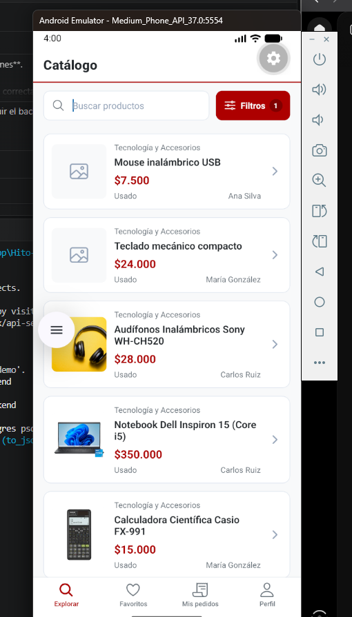
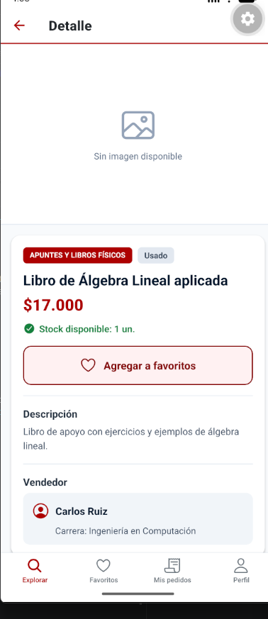
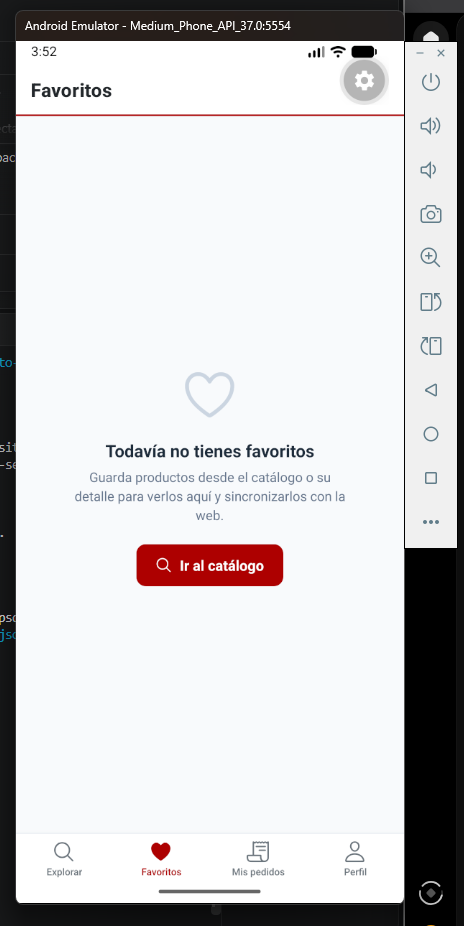
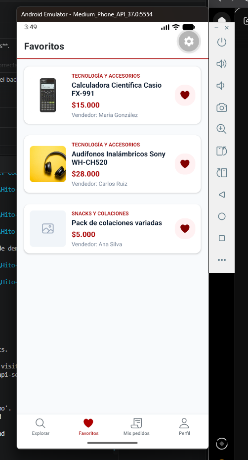
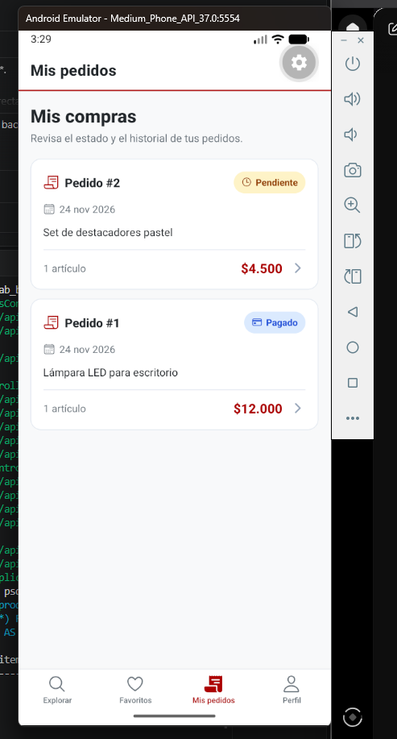
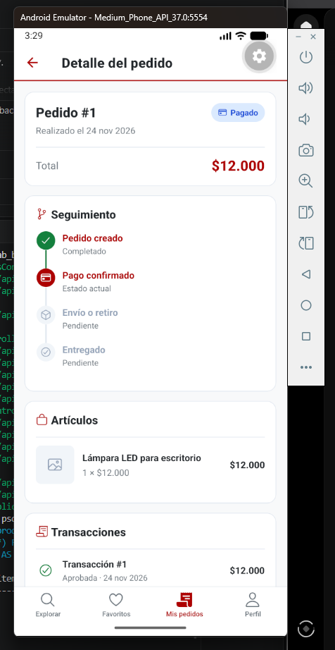
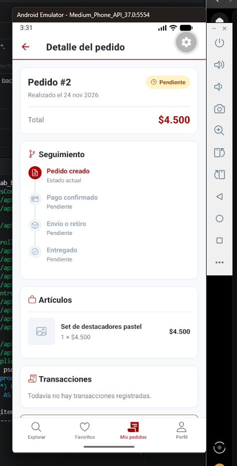
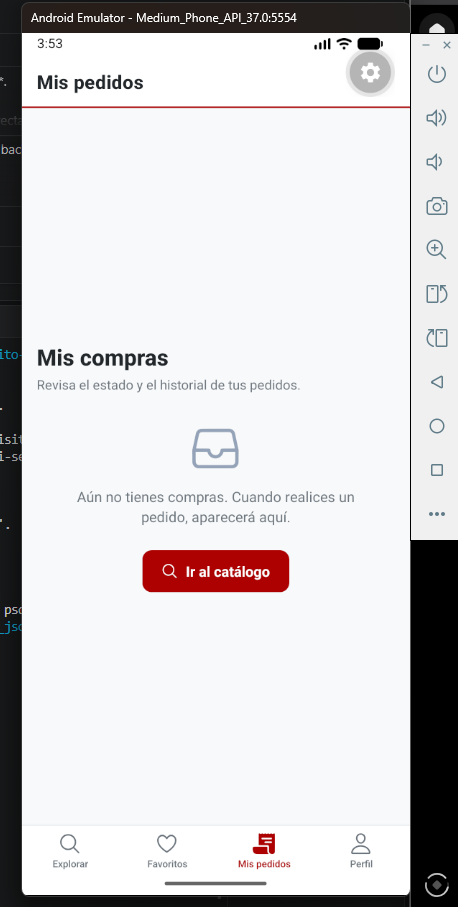
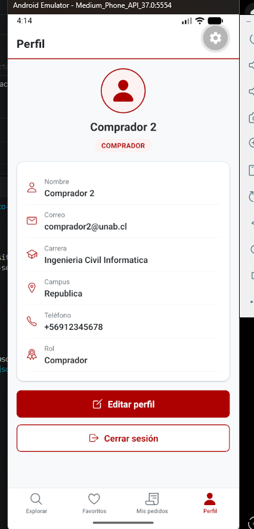
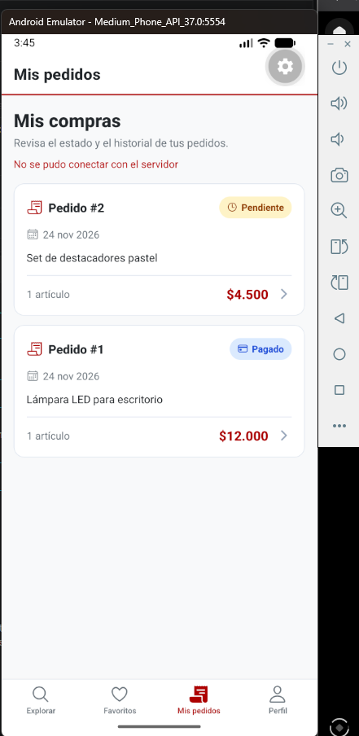

# Hito-4
## Marketplace UNAB - Aplicación móvil

Marketplace UNAB Móvil es una aplicación desarrollada con React Native y Expo que permite explorar productos, consultar detalles, administrar favoritos, revisar pedidos y gestionar el perfil de usuario.

La aplicación utiliza el mismo backend NestJS y las mismas bases de datos que la versión web.

### Requisitos previos

- Node.js y npm.
- Docker Desktop con Docker Compose.
- Android Studio con Android SDK y emulador configurado.
- ADB disponible desde la terminal.
- Repositorio del proyecto descargado.

### 1. Iniciar el backend

Desde la carpeta raíz del proyecto:

```powershell
docker compose up -d --build
```

Comprobar el estado del backend en:

http://localhost:3000/api/health

La respuesta debe indicar que PostgreSQL y MongoDB están disponibles.

### 2. Instalar las dependencias móviles

Desde la carpeta raíz del proyecto:

```powershell
cd mobile
npm ci
```

### 3. Configurar la conexión con la API

Crear `mobile/.env` a partir de `mobile/.env.example`.

Configuración propuesta para el emulador Android:

```env
EXPO_PUBLIC_API_URL=http://10.0.2.2:3000/api
```

Como alternativa, en nuestras pruebas se utilizó la redirección ADB.

Con el emulador encendido:

```powershell
adb reverse tcp:3000 tcp:3000
```

Configurar `mobile/.env` con:

```env
EXPO_PUBLIC_API_URL=http://127.0.0.1:3000/api
```

Esta alternativa requiere mantener activa la redirección ADB.

El archivo `.env` es local y no debe subirse a GitHub.

### 4. Ejecutar la aplicación en Android

Iniciar el emulador desde Android Studio.

Desde la carpeta `mobile`, ejecutar:

```powershell
npx expo start -c
```

Cuando Expo esté funcionando, presionar `a` para abrir la aplicación en Android.

Si se modifica la URL de la API, reiniciar Expo.


### 5. Funcionalidades móviles

La aplicación ofrece las siguientes funcionalidades:

**Autenticación**
- Inicio de sesión mediante correo y contraseña.
- Validación de credenciales y mensajes de error.
- Almacenamiento de sesión mediante Expo SecureStore.
- Recuperación de sesión y cierre de sesión.

**Catálogo**
- Exploración de productos disponibles.
- Búsqueda de productos por texto.
- Filtros por categoría, precio y condición.
- Ordenamiento de productos.
- Visualización de detalles, precios, stock y vendedores.

**Favoritos**
- Agregar y eliminar productos favoritos.
- Consultar productos guardados.
- Sincronización de favoritos entre catálogo y detalle.
- Mensaje informativo cuando no existen favoritos.

**Pedidos**
- Consultar el historial de pedidos del comprador.
- Visualizar estados y montos.
- Revisar productos y seguimiento de cada pedido.
- Consultar transacciones asociadas.
- Mostrar un estado vacío cuando no existen pedidos.

**Perfil**
- Consultar los datos personales del usuario.
- Editar nombre, carrera, campus y teléfono.
- Validar campos obligatorios.
- Conservar los cambios después de cerrar sesión.

**Manejo de errores**
- Mensajes ante problemas de conexión con la API.
- Recuperación de información al restablecer la conexión.
- Estados vacíos para búsquedas, favoritos y pedidos.


### 6. Endpoints utilizados

La aplicación móvil se comunica con la API REST de NestJS.

URL base utilizada en las pruebas:

`http://127.0.0.1:3000/api`

Esta dirección funciona en el emulador mediante la redirección ADB descrita anteriormente.

| Método | Endpoint | Función |
|---|---|---|
| POST | `/auth/login` | Iniciar sesión |
| GET | `/categories` | Obtener categorías |
| GET | `/products` | Consultar y filtrar productos |
| GET | `/products/:id` | Consultar detalle de producto |
| GET | `/favorites` | Obtener favoritos |
| POST | `/favorites/:productId` | Agregar favorito |
| DELETE | `/favorites/:productId` | Eliminar favorito |
| GET | `/orders` | Consultar pedidos del comprador |
| GET | `/orders/:id` | Consultar detalle de pedido |
| GET | `/users/me` | Obtener perfil del usuario |
| PATCH | `/users/me` | Actualizar perfil |

El servicio móvil de pedidos también implementa una llamada
`PATCH /orders/:id/status` para solicitar una cancelación.
Esta función se encuentra en el código, pero no fue validada
como una acción disponible en la interfaz durante las pruebas.

#### Autenticación y seguridad

El inicio de sesión utiliza correo y contraseña.

La API entrega un token de acceso JWT, que se incorpora
en las solicitudes autenticadas mediante:

`Authorization: Bearer <token>`

La sesión se almacena en el dispositivo con Expo SecureStore.

Si el backend responde con un error HTTP 401 ante una
solicitud autenticada, la aplicación cierra la sesión.

El cliente HTTP también contempla errores de conexión
y un tiempo de espera de 15 segundos.


### 7. Capturas de la aplicación

Las siguientes capturas fueron obtenidas durante las pruebas funcionales
realizadas en el emulador Android para el Hito 4.

#### Catálogo y detalle de productos

| Catálogo filtrado | Detalle de producto |
|---|---|
|  |  |

#### Favoritos

| Estado vacío | Productos favoritos |
|---|---|
|  |  |

#### Pedidos

| Historial de pedidos | Pedido pagado |
|---|---|
|  |  |

| Pedido pendiente | Estado sin compras |
|---|---|
|  |  |

#### Perfil y manejo de errores

| Perfil actualizado | API desconectada |
|---|---|
|  |  |

### 8. Uso de inteligencia artificial

#### Declaración personal - Tareas M03, M14 y M15

Durante el desarrollo de mis tareas del Hito 4 utilicé ChatGPT como herramienta de apoyo para configurar el entorno de desarrollo, resolver problemas de conectividad entre el emulador Android y el backend, organizar las pruebas funcionales y preparar la documentación técnica.

También utilicé Claude Code como apoyo en la implementación de los datos de demostración del backend. Posteriormente, revisé los cambios y comprobé su funcionamiento mediante Docker, PostgreSQL y el emulador Android.

Las herramientas de IA facilitaron el desarrollo y la resolución de problemas, mientras que las verificaciones, pruebas y decisiones de integración se realizaron bajo mi supervisión.

Esta declaración corresponde únicamente a mi participación en el proyecto. Cada integrante debe documentar su propio uso de herramientas de inteligencia artificial.
