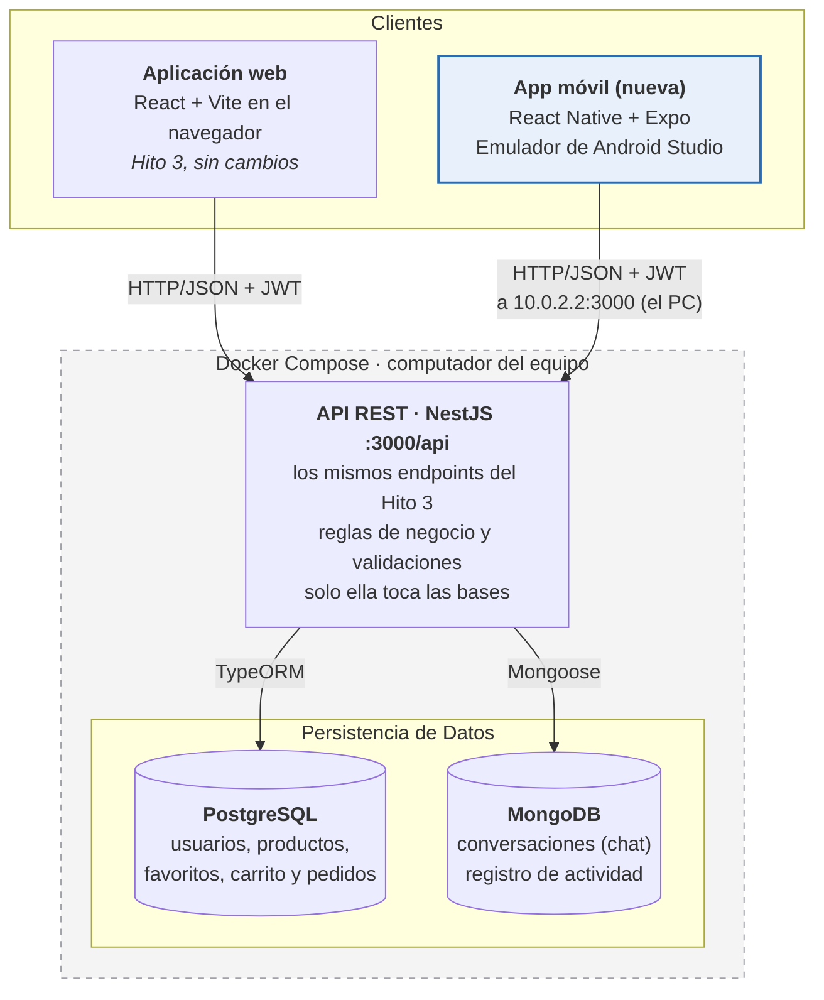

# Arquitectura Hito 4 — Marketplace UNAB (Web + Móvil)

La aplicación móvil desarrollada en **React Native + Expo** actúa como un segundo cliente del Marketplace UNAB, consumiendo exactamente la misma **API REST en NestJS** del Hito 3 mediante peticiones **HTTP/JSON autenticadas con JWT**. Ninguno de los clientes se conecta directamente a las bases de datos (**PostgreSQL** y **MongoDB**); toda la lógica de negocio, validaciones y persistencia continúa centralizada en la API.

## Diagrama de Arquitectura (Dos clientes, una API, dos bases)

## Flujo de comunicación y sincronización

| Componente | Tecnología | Rol en el sistema |
| :--- | :--- | :--- |
| **Cliente Web** | React + Vite | Interfaz web existente del Hito 3 (`http://localhost:3000/api`). |
| **Cliente Móvil** | React Native + Expo | Aplicación Android que consume la API a través de `http://10.0.2.2:3000/api` (`EXPO_PUBLIC_API_URL`). |
| **Backend API** | NestJS + JWT | Único punto de acceso a los datos; valida tokens Bearer, permisos y reglas de negocio. |
| **Base Relacional** | PostgreSQL (TypeORM) | Almacena usuarios, productos, categorías, favoritos, carritos y pedidos compartidos entre web y móvil. |
| **Base Documental** | MongoDB (Mongoose) | Almacena conversaciones/mensajes y el registro de actividad. |

## Decisiones técnicas clave

* **Separación cliente-servidor:** La app móvil solo realiza peticiones HTTP/JSON hacia `/api` con `fetch`; nunca accede directamente a PostgreSQL ni a MongoDB.
* **Estado compartido en tiempo real entre plataformas:** Al compartir el mismo endpoint `/api/favorites` y la misma tabla en PostgreSQL, agregar o quitar un favorito desde el emulador Android se refleja al instante en la aplicación web.
* **Resolución de red en Android Emulator:** Dentro del emulador, `localhost` apunta al propio teléfono virtual; `10.0.2.2` redirige el tráfico hacia el `localhost` del computador anfitrión donde corre Docker Compose.
* **Almacenamiento seguro de sesión:** El token JWT entregado por `POST /api/auth/login` se persiste cifrado en el dispositivo mediante `expo-secure-store` y se adjunta en cada solicitud protegida (`Authorization: Bearer <token>`).
