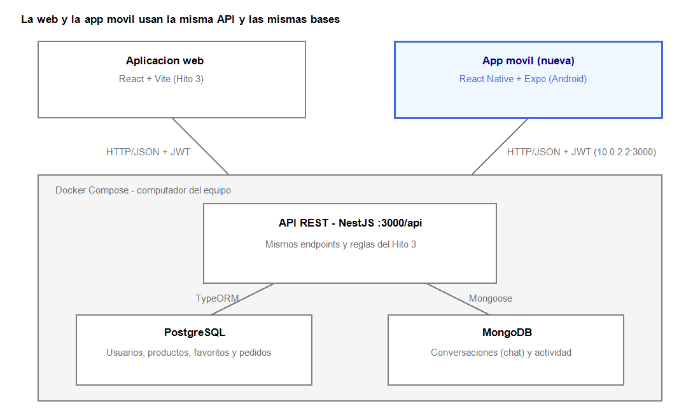

# Arquitectura Hito 4 - Marketplace UNAB (Web + Móvil)

La aplicación móvil desarrollada en **React Native + Expo** actúa como un segundo cliente del Marketplace UNAB, consumiendo la misma **API REST en NestJS**- del Hito 3 mediante peticiones **HTTP/JSON autenticadas con JWT**. Ninguno de los clientes se conecta directamente a las bases de datos (**PostgreSQL** **MongoDB**).



## Diagrama en Mermaid (Dos clientes, una API, dos bases)

```mermaid
flowchart TB
    subgraph Clientes["Clientes"]
        direction LR
        Web["<b>Aplicación web</b><br/>React + Vite en el navegador<br/><i>Hito 3, sin cambios</i>"]
        Mobile["<b>App móvil (nueva)</b><br/>React Native + Expo<br/>Emulador de Android Studio"]
    end

    subgraph Docker["Docker Compose µ computador del equipo"]
        direction TB
        API["<b>API REST · NestJS :3000/api</b><br/>los mismos endpoints del Hito 3<br/>reglas de negocio y validaciones<br/>solo ella toca las bases"]

        subgraph Bases["Persistencia de Datos"]
            direction LR
            PG[(("<b>PostgreSQL</b><br/>usuarios, productos,<br/>favoritos, carrito y pedidos")]
            Mongo[("<b>MongoDB</b><br/>conversaciones (chat)<br/>registro de actividad")]
        end

        API -- "TypeORM" --> PG
        API -- "Mongoose" --> Mongo
    end

    Web -- "HTTP/JSON + JWT" --> API
    Mobile -- "HTTP/JSON + JWT<br/>a 10.0.2.2:3000 (el PC)" --> API

    style Mobile fill:#e8f1fb,stroke:#2b6cb0,stroke-width:2px
    style Docker fill:#f4f4f5,stroke:#a1a1aa,stroke-dasharray: 5 5
```

## Componentes y reglas de integración

- **Cliente Web:** React + Vite (http://localhost:3000/api).
- **Cliente Móvil:** React Native + Expo a través de `EXPO_PUBLIC_API_URL=http://10.0.2.2:3000/api`.
- **API REST (NestJS):** Único punto de acceso a las bases; valida JWT y reglas de negocio.
- **PostgreSQL + MongoDB:** Persistencia compartida que garantiza que los favoritos y pedidos se reflejen entre móvil y web.
